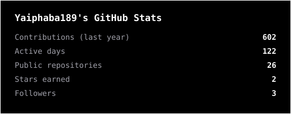
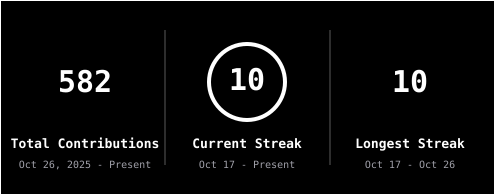
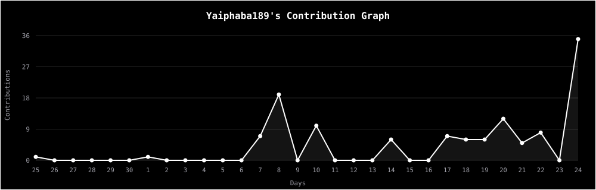

 

<h2 align="center">About me</h2>

Hello there! I'm <b>Khumbongmayum Yaiphaba Singh</b>, an AI/ML engineer. 
I engineer intelligent software systems, combining applied machine learning, large language models and scalable backend architecture to solve real-world problems.

 

<h2 align="center">Technologies</h2>

 

 

 

 

<h2 align="center">Statistics</h2>

